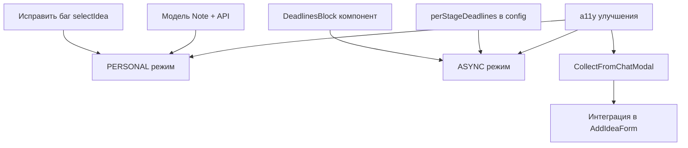

# Анализ архитектуры для реализации ASYNC/PERSONAL, CollectFromChatModal и a11y

> Дата: 2026-11-22
> Цель: Понять текущую архитектуру для реализации режимов ASYNC/PERSONAL, компонента CollectFromChatModal и улучшений доступности (a11y).

---

## 1. Схема данных и типы

### 1.1 Prisma schema (`server/prisma/schema.prisma`)

**Ключевые модели:**

| Модель | Поля | Значение для задач |
|--------|------|-------------------|
| [`Session`](server/prisma/schema.prisma:51) | `id`, `organizerId`, `topic`, `mode` (SessionMode), `config` (Json), `currentStage` (SessionStage), `stageDeadline` (DateTime?), `selectedIdeaId`, `status` | Поле `mode` уже поддерживает ASYNC и PERSONAL. `stageDeadline` используется для таймера/дедлайнов. `config` (JSON) хранит настройки: voteLimit, finalistsCount, duration-ы этапов. |
| [`Idea`](server/prisma/schema.prisma:72) | `id`, `sessionId`, `authorId`, `title`, `content`, `status` (IdeaStatus), `selectedAt`, `selectedById`, `isSelected` | `isSelected` + `selectedById` используются для режима PERSONAL (выбор идеи). |
| [`Vote`](server/prisma/schema.prisma:115) | `id`, `sessionId`, `ideaId`, `userId` | @@unique([sessionId, userId, ideaId]). Для PERSONAL может не использоваться (заметки вместо голосов). |
| [`Comment`](server/prisma/schema.prisma:129) | `id`, `ideaId`, `userId`, `text` | Используется для комментариев к идеям. |
| [`SessionMember`](server/prisma/schema.prisma:101) | `id`, `sessionId`, `userId`, `role` (ORGANIZER/PARTICIPANT) | Presence основан на этой модели + WebSocket. |

**Enums:**

- `SessionMode`: `QUICK`, `TEAM`, `ASYNC`, `PERSONAL` — **все 4 режима уже определены**
- `SessionStage`: `DISCUSSION`, `VOTING_ROUND_1`, `REFINEMENT`, `FINAL_VOTE`, `COMPLETED`
- `IdeaStatus`: `DRAFT`, `DISCUSSION`, `FINALIST`, `SELECTED`
- `SessionStatus`: `ACTIVE`, `COMPLETED`, `ARCHIVED`

### 1.2 Shared types (`shared/types.ts`)

Типы синхронизированы с Prisma:

- [`SessionMode`](shared/types.ts:15) — `'QUICK' | 'TEAM' | 'ASYNC' | 'PERSONAL'`
- [`Session`](shared/types.ts:21) — включает `mode`, `config`, `stageDeadline`, `currentStage`
- [`SessionConfig`](shared/types.ts:7) — `voteLimit`, `finalistsCount`, `discussionDurationMin`, `votingDurationMin`, `refinementDurationMin`
- [`SessionStatePayload`](shared/types.ts:148) — WS payload с полным состоянием сессии, включая `onlineUsers`

**WS события:**

- Сервер → клиент: `session_state`, `online_users`, `idea_created`, `vote_cast`, `vote_updated`, `vote_rejected`, `left_session`, `stage_changed`, `error`
- Клиент → сервер: `join_session`, `leave_session`, `create_idea`, `vote`, `cast_vote`

### 1.3 Выводы по схеме данных

1. **ASYNC режим** — схема уже готова. Поле `stageDeadline` существует и используется. Необходима только логика отображения дедлайнов вместо таймера обратного отсчета.
2. **PERSONAL режим** — схема готова. `selectIdea` уже реализован в [`ideaService.ts`](server/src/services/ideaService.ts:154) с проверкой режима PERSONAL. Поля `isSelected`, `selectedAt`, `selectedById` в модели Idea.
3. **Заметки вместо голосов** — требует нового поля в схеме (например, `Note` model или поля `note` в `Idea`). Текущая модель Vote не подходит для заметок.

---

## 2. Frontend компоненты

### 2.1 RoomHeader (`client/src/components/room/RoomHeader.tsx`)

**Текущая структура (344 строки):**

- [`StageProgressBar`](client/src/components/room/RoomHeader.tsx:61) — визуальный прогресс этапов (5 шагов)
- [`TimerDisplay`](client/src/components/room/RoomHeader.tsx:111) — использует [`useServerTimer`](client/src/hooks/useServerTimer.ts) для обратного отсчета до `stageDeadline`
- [`OnlineUsersDisplay`](client/src/components/room/RoomHeader.tsx:128) — AvatarGroup + счетчик онлайн
- [`StageDropdown`](client/src/components/room/RoomHeader.tsx:147) — dropdown для организатора (смена этапа)
- [`ConfirmStageModal`](client/src/components/room/RoomHeader.tsx:227) — модалка подтверждения смены этапа

**Пропсы:**

```typescript
interface RoomHeaderProps {
  topic: string;
  currentStage: SessionStage;
  stageDeadline: string | null;
  serverOffset: number;
  onlineUsers: string[];
  isOrganizer: boolean;
  onStageChange?: (newStage: SessionStage) => void;
}
```

**Что нужно изменить:**

| Задача | Изменение |
|--------|-----------|
| ASYNC | Заменить `TimerDisplay` на `DeadlinesBlock` (показывает дедлайны всех этапов вместо таймера). Добавить проп `mode: SessionMode`. |
| PERSONAL | Скрыть `OnlineUsersDisplay` (presence не нужен для одиночного режима). Добавить проп `mode`. |
| a11y | `StageProgressBar` уже имеет `aria-label`, `aria-current`, `aria-label` на шагах. `TimerDisplay` имеет `aria-live="polite"`. Dropdown имеет `aria-haspopup`, `aria-expanded`, `role="listbox"`. Модалка имеет `role="dialog"`, `aria-modal="true"`. |

### 2.2 SessionRoom (`client/src/pages/SessionRoom.tsx`)

**Текущая структура (494 строки):**

Основная страница комнаты сессии. Ключевые элементы:

- **WebSocket подключение** через [`useSessionSocket`](client/src/hooks/useSessionSocket.ts) — получает `sessionState`, `onlineUsers`, `currentStage`, `stageDeadline`
- **Кэш голосов** `ideaVotes` — локальный state, синхронизация через WS события `vote_updated`/`vote_rejected`
- **Кэш комментариев** `ideaComments` — синхронизация через REST API
- **Оптимистичное голосование** через [`useOptimisticMutation`](client/src/hooks/useOptimisticMutation.ts)
- **Сайдбар** — `VotesPanel` + `LeadersPanel` (desktop), drawer с участниками (mobile)
- **Connection Status** — фиксированный индикатор внизу

**Пропсы для дочерних компонентов:**

```tsx
<RoomHeader topic={topic} currentStage={stage} stageDeadline={stageDeadline} ... />
<StageContent sessionId={sessionId} currentStage={stage} ideas={ideas} ... />
<VotesPanel votesRemaining={remainingVotes} votesTotal={voteLimit} />
```

**Что нужно изменить:**

| Задача | Изменение |
|--------|-----------|
| ASYNC | Передать `mode` в `RoomHeader`. Возможно, изменить логику `stageDeadline` (несколько дедлайнов вместо одного). |
| PERSONAL | Скрыть `VotesPanel` (нет голосов). Скрыть `LeadersPanel`. Скрыть presence в RoomHeader. Добавить "заметки" вместо голосов на карточках. |
| CollectFromChatModal | Новый компонент, доступный из `AddIdeaForm` или отдельно. |

### 2.3 IdeaCard (`client/src/components/room/IdeaCard.tsx`)

**Текущая структура (186 строк):**

Карточка идеи с:
- Заголовок + бейдж статуса (FINALIST/SELECTED)
- Контент с сворачиванием (line-clamp-4)
- Автор (Avatar + имя)
- Голоса (счетчик + AvatarGroup голосовавших)
- Комментарии (индикатор + CommentsThread)
- Кнопка голосования ("Голосовать" / "Проголосовано" / "Выбрать" при FINAL_VOTE)

**Пропсы:**

```typescript
interface IdeaCardProps {
  idea: Idea;
  currentStage: SessionStage;
  remainingVotes: number;
  hasVoted: boolean;
  voteCount: number;
  votingUserIds: string[];
  comments?: CommentItem[];
  onVote: (ideaId: string) => void;
  onAddComment?: (ideaId: string, text: string) => Promise<void>;
}
```

**Что нужно изменить:**

| Задача | Изменение |
|--------|-----------|
| PERSONAL | Кнопка "Выбрать" вместо "Голосовать". Скрыть счетчик голосов/аватары. Добавить поле заметки (textarea) с сохранением. |
| a11y | Добавить `aria-label` на кнопку голосования. Убедиться, что `aria-expanded` на сворачивании работает корректно. |

### 2.4 VotesPanel (`client/src/components/room/VotesPanel.tsx`)

**Текущая структура (69 строк):**

Панель с:
- Счетчик "Осталось X из Y"
- Визуальный индикатор точек (filled/empty circles)
- Подсказка при исчерпании голосов

**Что нужно изменить:**

| Задача | Изменение |
|--------|-----------|
| PERSONAL | Скрыть entirely. Заменить на панель заметок (новый компонент или расширение). |

### 2.5 StageContent (`client/src/components/room/StageContent.tsx`)

**Текущая структура (244 строки):**

Рендерит контент в зависимости от этапа:
- **DISCUSSION/VOTING_ROUND_1** — `IdeaFeed` со всеми идеями
- **REFINEMENT** — сетка финалистов с `IdeaEditor` (редактирование)
- **FINAL_VOTE** — финалисты с кнопкой "Выбрать"
- **COMPLETED** — редирект на `SessionResult`

**Пропсы:**

```typescript
interface StageContentProps {
  sessionId: string;
  currentStage: SessionStage;
  ideas: Idea[];
  currentUserId: string;
  isOrganizer: boolean;
  onAddIdea: (title: string, content: string) => void;
  onVote: (ideaId: string) => void;
  votes: IdeaVotesMap;
  presence?: { userId: string; userName: string } | null;
  voteLimit?: number;
  ideaComments?: Record<string, CommentItem[]>;
  onAddComment?: (ideaId: string, text: string) => Promise<void>;
  onIdeaUpdated?: (idea: Idea) => void;
}
```

**Что нужно изменить:**

| Задача | Изменение |
|--------|-----------|
| ASYNC | Возможно, изменить логику отображения этапов (дедлайны вместо автоматических переходов). |
| PERSONAL | Упростить: нет presence, нет голосов. Добавить заметки на карточки. |

---

*Продолжение в разделах 3-5...*

---

## 3. API слой и бэкенд

### 3.1 Client API — Ideas (`client/src/api/ideas.ts`)

**Реализованные методы:**

| Метод | Эндпоинт | Описание |
|-------|----------|----------|
| [`updateIdea()`](client/src/api/ideas.ts:25) | PATCH /api/ideas/:id | Обновление title/content (REFINEMENT) |
| [`getSessionIdeas()`](client/src/api/ideas.ts:42) | GET /api/ideas?sessionId=... | Список идей сессии |
| [`addCommentToIdea()`](client/src/api/ideas.ts:56) | POST /api/ideas/:id/comments | Комментарий к идее |

**Чего не хватает:**

| Метод | Эндпоинт | Зачем нужен |
|-------|----------|-------------|
| `selectIdea()` | POST /api/ideas/:id/select | PERSONAL режим — выбор идеи |
| `structureFromChat()` | POST /api/ideas/from-chat | CollectFromChatModal — структурирование через LLM |
| `addNoteToIdea()` | POST /api/ideas/:id/note | PERSONAL режим — заметки вместо голосов |

### 3.2 Client API — Sessions (`client/src/api/sessions.ts`)

**Реализованные методы:**

| Метод | Эндпоинт | Описание |
|-------|----------|----------|
| [`getSessionList()`](client/src/api/sessions.ts:35) | GET /api/sessions | Список сессий пользователя |
| [`createSession()`](client/src/api/sessions.ts:42) | POST /api/sessions | Создание сессии (mode, config, topic) |
| [`getSessionDetails()`](client/src/api/sessions.ts:58) | GET /api/sessions/:id | Детали сессии |
| [`duplicateSession()`](client/src/api/sessions.ts:71) | GET + POST | Дублирование сессии |

**CreateSessionPayload** включает `mode: SessionMode` — создание ASYNC/PERSONAL сессий уже поддерживается.

### 3.3 Backend Routes — Ideas (`server/src/routes/ideas.ts`)

**Зарегистрированные маршруты (279 строк):**

| Метод | Путь | Описание | Права |
|-------|------|----------|-------|
| POST | /ideas | Создание идеи | Участник, DISCUSSION |
| GET | /ideas?sessionId= | Список идей | Участник |
| GET | /ideas/:id | Детали идеи + комментарии | Участник |
| PATCH | /ideas/:id | Обновление идеи | Автор/Организатор, REFINEMENT |
| POST | /ideas/:id/select | Выбор идеи | Организатор, PERSONAL |
| POST | /ideas/:id/comments | Комментарий | Участник |
| POST | /ideas/from-chat | Структурирование LLM | Любой авторизованный |

**Zod схемы валидации:**

- [`createIdeaSchema`](server/src/routes/ideas.ts:22) — title (1-200), content (1-5000), sessionId
- [`updateIdeaSchema`](server/src/routes/ideas.ts:28) — title/content optional, минимум одно поле
- [`commentSchema`](server/src/routes/ideas.ts:37) — text (1-1000)
- [`structureFromChatSchema`](server/src/routes/ideas.ts:41) — sessionId, chatText

### 3.4 Backend Service — IdeaService (`server/src/services/ideaService.ts`)

**Ключевые функции:**

| Функция | Описание | Проверки |
|---------|----------|----------|
| [`createIdea()`](server/src/services/ideaService.ts:67) | Создание идеи | checkSessionStage('DISCUSSION') |
| [`updateIdea()`](server/src/services/ideaService.ts:94) | Обновление | Автор/Организатор + REFINEMENT |
| [`selectIdea()`](server/src/services/ideaService.ts:154) | Выбор идеи | Организатор + PERSONAL stage |
| [`addComment()`](server/src/services/ideaService.ts:187) | Комментарий | Существование идеи |
| [`structureFromChat()`](server/src/services/ideaService.ts:210) | LLM структурирование | Валидация результата |
| [`getIdeasForSession()`](server/src/services/ideaService.ts:243) | Список идей | include: author, comments, votes |

**Важное наблюдение:** Функция [`selectIdea()`](server/src/services/ideaService.ts:154) проверяет `checkSessionStage(idea.sessionId, 'PERSONAL')` — но `'PERSONAL'` не является значением enum `SessionStage` (это `SessionMode`). Это **баг**: проверка должна быть на `session.mode === 'PERSONAL'`, а не на `session.currentStage`.

### 3.5 WebSocket Context (`client/src/context/SessionSocketContext.tsx`)

**Архитектура (427 строк):**

- **Provider** [`SessionSocketProvider`](client/src/context/SessionSocketContext.tsx:90) — управляет WebSocket соединением
- **Event emitter** — внутренняя система подписок на WS события
- **Auto-reconnect** с exponential backoff (1s → 2s → 4s → ... → 30s max)
- **REST sync** при реконнекте — `/api/sessions/:id/state`
- **Server offset** — вычисляется из `createdAt` сессии (может быть неточным)

**Состояние контекста:**

```typescript
interface SessionSocketValue {
  socket: WebSocket | null;
  isConnected: boolean;
  onlineUsers: string[];
  currentStage: SessionStage | null;
  stageDeadline: string | null;
  serverOffset: number;
  sessionId: string | null;
  sessionState: SessionStatePayload | null;
  joinSession, leaveSession, send, on
}
```

**Для ASYNC/PERSONAL:**

- Контекст уже передает `sessionState.mode` через payload — доступно для условной логики
- `onlineUsers` не нужен для PERSONAL — но приходит от сервера anyway
- `stageDeadline` — один дедлайн. Для ASYNC может понадобиться массив дедлайнов по этапам

### 3.6 Выводы по API и бэкенду

1. **selectIdea endpoint** уже реализован на бэкенде, но клиентский API метод отсутствует.
2. **structureFromChat endpoint** существует (`POST /ideas/from-chat`), но клиентский метод отсутствует.
3. **Заметки (PERSONAL)** — требуется новая модель `Note` в Prisma + новые эндпоинты.
4. **Баг в selectIdea** — проверка `checkSessionStage('PERSONAL')` неверна (PERSONAL — это mode, не stage).
5. **Деdлайны ASYNC** — текущая схема хранит один `stageDeadline`. Для ASYNC с индивидуальными дедлайнами по этапам необходимо либо расширить `config` (JSON), либо добавить таблицу `StageDeadline`.

---

## 4. UI компоненты и стили

### 4.1 Дизайн-система Tailwind (`client/tailwind.config.js`)

**Семантическая палитра:**

| Токен | Цвет | Использование |
|-------|------|---------------|
| `primary` | #2563EB / #1D4ED8 / #EFF6FF | Основные действия, фокус |
| `success` | #10B981 / #ECFDF5 | Успех, завершено |
| `warning` | #F59E0B / #FFFBEB | Предупреждения |
| `danger` | #EF4444 / #FEF2F2 | Ошибки, финал |
| `stage.discussion` | #3B82F6 | Этап обсуждения |
| `stage.voting` | #F59E0B | Этап голосования |
| `stage.refinement` | #8B5CF6 | Этап доработки |
| `stage.final` | #EF4444 | Финальное голосование |
| `stage.completed` | #10B981 | Завершено |
| `neutral.50-900` | Серая шкала | Текст, фоны, границы |

**Правила (из front.md):**
- Только семантические классы (НЕ blue-600, gray-100)
- Отступы: шкала 1–12 (4px шаг)
- Радиусы: rounded-sm/md/lg
- Запрещено: arbitrary values, стандартная палитра Tailwind, inline-стили
- Focus: `focus-visible:outline-none focus-visible:ring-2 focus-visible:ring-primary focus-visible:ring-offset-2`
- Disabled: `disabled:opacity-50 disabled:cursor-not-allowed`

### 4.2 Примитивы UI

#### Button (`client/src/components/ui/Button.tsx`)

| Проп | Значения | Описание |
|------|----------|----------|
| `variant` | `primary`, `secondary`, `ghost`, `danger` | Стиль кнопки |
| `size` | `sm`, `md`, `lg` | Размер |
| `loading` | boolean | Спиннер |
| `fullWidth` | boolean | Полная ширина |

Focus ring реализован. Disabled opacity реализован.

#### Card (`client/src/components/ui/Card.tsx`)

- Базовые стили: `rounded-md border border-neutral-200 bg-white shadow-card`
- Опциональный `title` (header с border-bottom)
- `accentColor` — цветная граница (discussion/voting/refinement/final/completed)

#### Badge (`client/src/components/ui/Badge.tsx`)

- Варианты: discussion, voting, refinement, final, completed
- Цветные бейджи с белым текстом

#### Avatar / AvatarGroup (`client/src/components/ui/Avatar.tsx`)

- Детерминированный цвет по userId (hash)
- Инициалы из имени
- Размеры: sm (32px), md (40px), lg (48px)
- AvatarGroup с overflow badge (+N)

### 4.3 Глобальные стили (`client/src/index.css`)

Минимальный файл — только @tailwind директивы и base layer для body.

### 4.4 Хук useServerTimer (`client/src/hooks/useServerTimer.ts`)

```typescript
interface UseServerTimerResult {
  remainingMs: number;
  formatted: string;  // "MM:SS"
  isExpired: boolean;
}
```

- Принимает `deadline` (string | null) и `serverOffset` (number)
- Обновляется каждую секунду
- `onExpire` callback (один раз при истечении)

**Для ASYNC:** Подходит для одного дедлайна. Для блока дедлайнов (несколько этапов) потребуется несколько инстансов или новый компонент.

### 4.5 a11y аудит текущего состояния

| Компонент | Текущее состояние a11y | Проблемы |
|-----------|----------------------|----------|
| RoomHeader | `aria-label` на progress, `aria-current="step"`, `aria-live="polite"` на таймере, `aria-haspopup`/`aria-expanded` на dropdown, `role="dialog"` на модалке | ✅ Хорошее покрытие |
| IdeaCard | `aria-expanded` на кнопке сворачивания | ❌ Нет `aria-label` на кнопке голосования. Нет `role` на карточке. |
| VotesPanel | `role="progressbar"`, `aria-valuenow/min/max`, `aria-label` | ✅ Хорошее покрытие |
| IdeaFeed | `role="tablist"`, `role="tab"`, `aria-selected` на сортировке | ✅ Хорошее покрытие |
| AddIdeaForm | Форма с валидацией | ❌ Ошибки не связаны с input через `aria-describedby`/`aria-invalid` |
| StageDropdown | `role="listbox"`, `role="option"` | ✅ Хорошее покрытие |
| ConfirmStageModal | `role="dialog"`, `aria-modal="true"`, `aria-labelledby`, Escape handler | ❌ Нет focus trap (focus management) |
| Connection Status | Статический текст | ❌ Нет `aria-live` для изменений статуса |

### 4.6 Выводы по UI и стилям

1. **Дизайн-система** готова для новых компонентов — использовать существующие примитивы (Button, Card, Badge, Avatar, Input).
2. **ASYNC DeadlinesBlock** — новый компонент, использующий Card + Badge для отображения дедлайнов этапов.
3. **PERSONAL NotesPanel** — замена VotesPanel. Textarea + Button для заметок.
4. **CollectFromChatModal** — Modal (overlay + Card) с textarea для ввода текста чата и кнопкой "Структурировать".
5. **a11y улучшения:**
   - Добавить `aria-describedby`/`aria-invalid` в AddIdeaForm
   - Добавить focus trap в ConfirmStageModal
   - Добавить `aria-label` на кнопки IdeaCard
   - Добавить `aria-live` на Connection Status
   - Проверить keyboard navigation в StageDropdown (стрелки вверх/вниз)

---

## 5. План реализации по задачам

### 5.1 ASYNC режим — блок дедлайнов вместо таймера

**Что уже есть:**
- Поле `mode: 'ASYNC'` в Session
- Поле `stageDeadline` (один дедлайн текущего этапа)
- `TimerDisplay` компонент с `useServerTimer`

**Что нужно сделать:**

| # | Задача | Файл | Описание |
|---|--------|------|----------|
| 1 | Добавить `perStageDeadlines` в `SessionConfig` | `shared/types.ts` | Расширить интерфейс: `perStageDeadlines?: Record<SessionStage, string>` |
| 2 | Создать компонент `DeadlinesBlock` | `client/src/components/room/DeadlinesBlock.tsx` | Показывает все этапы с дедлайнами. Использует Card + Badge. Каждый этап: название + дата/время + статус (прошедший/текущий/будущий). |
| 3 | Обновить `RoomHeader` | `client/src/components/room/RoomHeader.tsx` | Добавить проп `mode`. При `mode === 'ASYNC'` рендерить `DeadlinesBlock` вместо `TimerDisplay`. |
| 4 | Обновить `SessionRoom` | `client/src/pages/SessionRoom.tsx` | Передать `mode` из `sessionState.mode` в RoomHeader. |
| 5 | Бэкенд: поддержка perStageDeadlines | `server/src/services/sessionService.ts` | При создании ASYNC сессии вычислять дедлайны для каждого этапа из config. |

**Архитектура DeadlinesBlock:**

```
┌─────────────────────────────────┐
│  Дедлайны этапов                │
├─────────────────────────────────┤
│  ● Обсуждение    25 ноя, 18:00  │ ← текущий (bg-stage-discussion)
│  ○ Голосование   26 ноя, 12:00  │ ← будущий
│  ○ Доработка     27 ноя, 12:00  │
│  ○ Финал         28 ноя, 12:00  │
└─────────────────────────────────┘
```

### 5.2 PERSONAL режим — скрытие presence, заметки вместо голосов, "Выбрать"

**Что уже есть:**
- `mode: 'PERSONAL'` в Session
- `selectIdea()` на бэкенде (POST /ideas/:id/select)
- Поля `isSelected`, `selectedAt`, `selectedById` в Idea

**Что нужно сделать:**

| # | Задача | Файл | Описание |
|---|--------|------|----------|
| 1 | Добавить модель `Note` в Prisma | `server/prisma/schema.prisma` | `Note { id, ideaId, userId, text, createdAt }` — заметка пользователя к идее |
| 2 | Добавить типы Note | `shared/types.ts` | `interface Note { id, ideaId, userId, text, createdAt }` |
| 3 | Бэкенд: маршруты заметок | `server/src/routes/ideas.ts` | POST /ideas/:id/note (создать/обновить), GET /ideas/:id/note (получить) |
| 4 | Бэкенд: сервис заметок | `server/src/services/ideaService.ts` | `addNote()`, `getNote()` — upsert по (ideaId, userId) |
| 5 | Клиентский API заметок | `client/src/api/ideas.ts` | `addNoteToIdea()`, `getNoteForIdea()` |
| 6 | Исправить баг selectIdea | `server/src/services/ideaService.ts:164` | Заменить `checkSessionStage('PERSONAL')` на проверку `session.mode === 'PERSONAL'` |
| 7 | Клиентский API selectIdea | `client/src/api/ideas.ts` | `selectIdea(ideaId)` → POST /ideas/:id/select |
| 8 | Обновить `RoomHeader` | `client/src/components/room/RoomHeader.tsx` | При `mode === 'PERSONAL'` скрыть `OnlineUsersDisplay`. |
| 9 | Создать `NotesPanel` | `client/src/components/room/NotesPanel.tsx` | Замена VotesPanel для PERSONAL. Показывает информацию о заметках. |
| 10 | Обновить `IdeaCard` | `client/src/components/room/IdeaCard.tsx` | При `mode === 'PERSONAL'`: скрыть голоса/аватары, добавить textarea для заметки, кнопка "Выбрать" вместо "Голосовать". |
| 11 | Обновить `SessionRoom` | `client/src/pages/SessionRoom.tsx` | При PERSONAL: скрыть VotesPanel, LeadersPanel. Рендерить NotesPanel. |
| 12 | Обновить `StageContent` | `client/src/components/room/StageContent.tsx` | Передать `mode` в IdeaCard. Упростить логику для PERSONAL. |

**Архитектура IdeaCard в PERSONAL:**

```
┌─────────────────────────────────┐
│  Заголовок идеи         [Выбрана]│
├─────────────────────────────────┤
│  Контент идеи...                │
│                                 │
│  📝 Ваша заметка:               │
│  ┌───────────────────────────┐  │
│  │ Текст заметки...          │  │
│  └───────────────────────────┘  │
│  [Сохранить заметку]            │
│                                 │
│  [Выбрать эту идею]  ← primary  │
└─────────────────────────────────┘
```

### 5.3 CollectFromChatModal — компонент структурирования из чата

**Что уже есть:**
- Эндпоинт POST /ideas/from-chat (бэкенд)
- `structureFromChat()` в ideaService → вызывает LLM
- `structureIdeaFromChat()` в `server/src/lib/llm.ts`

**Что нужно сделать:**

| # | Задача | Файл | Описание |
|---|--------|------|----------|
| 1 | Клиентский API | `client/src/api/ideas.ts` | `structureFromChat(chatText)` → POST /ideas/from-chat |
| 2 | Создать компонент | `client/src/components/room/CollectFromChatModal.tsx` | Modal с textarea + кнопкой "Структурировать". Показывает результат (title + content) с кнопками "Использовать" / "Отмена". |
| 3 | Интеграция в AddIdeaForm | `client/src/components/room/AddIdeaForm.tsx` | Добавить кнопку "Из чата" → открывает CollectFromChatModal. При подтверждении — заполняет форму. |
| 4 | Состояния UI | CollectFromChatModal.tsx | Loading (спиннер при LLM запросе), Error (сообщение + повторить), Success (результат с действиями). |

**Архитектура CollectFromChatModal:**

```
┌─────────────────────────────────┐
│  Структурировать из чата    [✕] │
├─────────────────────────────────┤
│  Вставьте текст чата:           │
│  ┌───────────────────────────┐  │
│  │ Текст чата...             │  │
│  │                           │  │
│  │                           │  │
│  └───────────────────────────┘  │
│                                 │
│  [Структурировать через AI]     │
│                                 │
│  ─── Результат ───              │
│  Заголовок: "..."               │
│  Контент: "..."                 │
│  [Использовать] [Отмена]        │
└─────────────────────────────────┘
```

### 5.4 a11y улучшения

| # | Задача | Файл | Описание |
|---|--------|------|----------|
| 1 | AddIdeaForm — aria | `client/src/components/room/AddIdeaForm.tsx` | Добавить `aria-invalid`, `aria-describedby` на input/textarea. Связать ошибки валидации с полями. |
| 2 | ConfirmStageModal — focus trap | `client/src/components/room/RoomHeader.tsx` | Добавить focus trap: Tab циклически внутри модалки. Возврат фокуса при закрытии. |
| 3 | IdeaCard — aria-label | `client/src/components/room/IdeaCard.tsx` | Добавить `aria-label` на кнопку голосования: "Голосовать за {title}" / "Проголосовано за {title}". |
| 4 | Connection Status — aria-live | `client/src/pages/SessionRoom.tsx` | Обернуть статус подключения в `aria-live="polite"`. |
| 5 | StageDropdown — keyboard nav | `client/src/components/room/RoomHeader.tsx` | Добавить навигацию стрелками в listbox. ArrowDown/ArrowUp между option-ами. |
| 6 | Skip to content | `client/src/main.tsx` или layout | Добавить "Перейти к содержимому" ссылку для клавиатурных пользователей. |

---

## 6. Зависимости и порядок реализации



**Рекомендуемый порядок:**

1. **Исправить баг selectIdea** — критично для PERSONAL
2. **Модель Note + API заметок** — база для PERSONAL
3. **PERSONAL режим** — RoomHeader, IdeaCard, SessionRoom
4. **DeadlinesBlock + ASYNC** — независимая задача
5. **CollectFromChatModal** — независимая задача
6. **a11y улучшения** — можно делать параллельно с другими задачами

## 7. Риски и замечания

1. **Баг в selectIdea** — проверка `checkSessionStage('PERSONAL')` приведёт к ошибке, так как PERSONAL не является значением SessionStage enum. Требует немедленного исправления.
2. **WebSocket vs REST для ASYNC** — в асинхронном режиме пользователи могут не быть онлайн одновременно. WebSocket presence не критичен, но state sync через REST (`/sessions/:id/state`) должен быть надёжным.
3. **LLM стоимость** — endpoint `/ideas/from-chat` вызывает LLM. Добавить rate limiting и обработку ошибок (таймаут, недоступность API).
4. **Focus trap** — текущая модалка ConfirmStageModal не реализует focus trap. Это критично для клавиатурной навигации и screen readers.
5. **Синхронизация времени** — текущий `serverOffset` вычисляется из `createdAt` сессии, что может быть неточным. Рассмотреть отдельное WS событие `server_time` для точной синхронизации.
