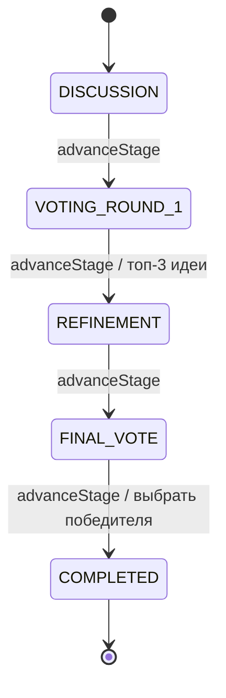

# План реализации: Stage Management для Brain-Storm Session

## Текущая структура данных

### Модель Session (Prisma)
| Поле | Тип | Описание |
|------|-----|----------|
| id | String @id @default(cuid()) | Уникальный ID |
| organizerId | String | ID организатора |
| topic | String | Тема сессии |
| mode | SessionMode | QUICK / TEAM / ASYNC / PERSONAL |
| config | Json | Конфигурация сессии |
| status | String | Статус ( ACTIVE / FINISHED и т.д.) |
| createdAt | DateTime | Время создания |
| ideas | Idea[] | Связанные идеи |

### Модель Idea (Prisma)
| Поле | Тип | Описание |
|------|-----|----------|
| id | String @id @default(cuid()) | Уникальный ID |
| sessionId | String | ID сессии |
| authorId | String | ID автора |
| title | String | Заголовок идеи |
| content | String | Содержание |
| status | IdeaStatus | DRAFT / DISCUSSION / FINALIST / SELECTED |
| createdAt | DateTime | Время создания |
| votes | Vote[] | Голоса за идею |
| comments | Comment[] | Комментарии |

### Модель Vote (Prisma)
| Поле | Тип | Описание |
|------|-----|----------|
| id | String @id @default(cuid()) | Уникальный ID |
| ideaId | String | ID идеи |
| userId | String | ID пользователя |
| createdAt | DateTime | Время голосования |

**Вывод:** Модель Idea уже имеет поле `status` (enum IdeaStatus с FINALIST, SELECTED) и связь с Vote. Это подходит для реализации логики advanceStage.

---

## Рекомендованные изменения

### Этап 1: Enum SessionStage в shared пакете

**Файл:** `shared/src/index.ts`

Добавить enum:
```typescript
export enum SessionStage {
  DISCUSSION = 'DISCUSSION',
  VOTING_ROUND_1 = 'VOTING_ROUND_1',
  REFINEMENT = 'REFINEMENT',
  FINAL_VOTE = 'FINAL_VOTE',
  COMPLETED = 'COMPLETED',
}
```

Также добавить тип для конфигурации этапов:
```typescript
export interface StageDurations {
  voting: number;      // минимальная длительность VOTING_ROUND_1 (мс)
  refinement: number;  // длительность REFINEMENT (мс)
  finalVote: number;   // длительность FINAL_VOTE (мс)
}

export const DEFAULT_STAGE_DURATIONS: StageDurations = {
  voting: 30 * 60 * 1000,       // 30 минут
  refinement: 15 * 60 * 1000,   // 15 минут
  finalVote: 20 * 60 * 1000,    // 20 минут
};
```

Обновить интерфейс SessionConfig:
```typescript
export interface SessionConfig {
  maxParticipants?: number;
  timeLimitMinutes?: number;
  allowAnonymousVotes?: boolean;
  voteLimit?: number;
  stageDurations?: StageDurations;  // опциональная переопределённая конфигурация
}
```

---

### Этап 2: Обновление Prisma схемы

**Файл:** `server/prisma/schema.prisma`

2.1. Добавить enum SessionStage:
```prisma
enum SessionStage {
  DISCUSSION
  VOTING_ROUND_1
  REFINEMENT
  FINAL_VOTE
  COMPLETED
}
```

2.2. Добавить поля в модель Session:
```prisma
model Session {
  // ... существующие поля ...
  currentStage   SessionStage @default(DISCUSSION)
  stageDeadline  DateTime?
  selectedIdeaId String?
  selectedIdea   Idea?        @relation("SelectedIdea", fields: [selectedIdeaId], references: [id])
  // ...
}
```

2.3. Создать migration:
```bash
npx prisma migrate dev --name add_session_stages
```

---

### Этап 3: Серверная функция advanceStage

**Файл:** `server/src/services/sessionStage.service.ts` (новый файл)

```typescript
import { PrismaClient } from '@prisma/client';
import { SessionStage, DEFAULT_STAGE_DURATIONS } from 'shared';

export async function advanceStage(
  prisma: PrismaClient,
  sessionId: string,
  customDurations?: Partial<StageDurations>
): Promise<{ newStage: SessionStage; deadline?: Date }> {
  const durations = { ...DEFAULT_STAGE_DURATIONS, ...customDurations };
  const session = await prisma.session.findUnique({ where: { id: sessionId } });

  if (!session) throw new Error('Session not found');

  switch (session.currentStage) {
    case SessionStage.DISCUSSION: {
      const deadline = new Date(Date.now() + durations.voting);
      const updated = await prisma.session.update({
        where: { id: sessionId },
        data: { currentStage: SessionStage.VOTING_ROUND_1, stageDeadline: deadline },
      });
      // Также перевести идеи из DRAFT в DISCUSSION
      await prisma.idea.updateMany({
        where: { sessionId, status: 'DRAFT' },
        data: { status: 'DISCUSSION' },
      });
      return { newStage: SessionStage.VOTING_ROUND_1, deadline };
    }

    case SessionStage.VOTING_ROUND_1: {
      // Найти топ-3 идеи по количеству голосов
      const ideas = await prisma.idea.findMany({
        where: { sessionId },
        include: { _count: { select: { votes: true } } },
        orderBy: { votes: { _count: 'desc' } },
        take: 3,
      });

      // Обновить статус финалистов
      const finalistIds = ideas.map((i) => i.id);
      await prisma.idea.updateMany({
        where: { sessionId, id: { in: finalistIds } },
        data: { status: 'FINALIST' },
      });

      const updated = await prisma.session.update({
        where: { id: sessionId },
        data: { currentStage: SessionStage.REFINEMENT, stageDeadline: null },
      });
      return { newStage: SessionStage.REFINEMENT };
    }

    case SessionStage.REFINEMENT: {
      const deadline = new Date(Date.now() + durations.finalVote);
      const updated = await prisma.session.update({
        where: { id: sessionId },
        data: { currentStage: SessionStage.FINAL_VOTE, stageDeadline: deadline },
      });
      return { newStage: SessionStage.FINAL_VOTE, deadline };
    }

    case SessionStage.FINAL_VOTE: {
      // Найти идею с максимумом голосов среди финалистов
      const topIdea = await prisma.idea.findFirst({
        where: { sessionId, status: 'FINALIST' },
        include: { _count: { select: { votes: true } } },
        orderBy: { votes: { _count: 'desc' } },
      });

      if (!topIdea) throw new Error('No finalist ideas found');

      await prisma.idea.update({
        where: { id: topIdea.id },
        data: { status: 'SELECTED' },
      });

      const updated = await prisma.session.update({
        where: { id: sessionId },
        data: {
          currentStage: SessionStage.COMPLETED,
          stageDeadline: null,
          selectedIdeaId: topIdea.id,
        },
      });
      return { newStage: SessionStage.COMPLETED };
    }

    case SessionStage.COMPLETED:
      throw new Error('Session is already completed');
  }
}
```

---

### Этап 4: Роут для advanceStage

**Файл:** `server/src/routes/sessions.ts`

Добавить маршрут:
```typescript
// POST /:id/advance — переход к следующему этапу
fastify.post('/:id/advance', async (request, reply) => {
  const { id } = request.params as { id: string };
  const userId = (request.user as { sub: string }).sub;

  const session = await fastify.prisma.session.findUnique({ where: { id } });
  if (!session) {
    reply.code(404).send({ error: 'Сессия не найдена' });
    return;
  }

  // Только организатор может переводить этапы
  if (session.organizerId !== userId) {
    reply.code(403).send({ error: 'Только организатор может переводить этапы' });
    return;
  }

  try {
    const result = await advanceStage(fastify.prisma, id, (session.config as any)?.stageDurations);
    reply.code(200).send(result);
  } catch (err) {
    reply.code(400).send({ error: (err as Error).message });
  }
});
```

---

### Этап 5: Обновление схем валидации

**Файл:** `server/src/schemas/session.schema.ts`

Добавить zod-схему для SessionStage:
```typescript
const SessionStage = z.enum([
  'DISCUSSION',
  'VOTING_ROUND_1',
  'REFINEMENT',
  'FINAL_VOTE',
  'COMPLETED',
]);
```

---

### Этап 6: WebSocket события для изменений этапа

**Файл:** `shared/src/index.ts`

Добавить события:
```typescript
export interface ServerToClientEvents {
  // ... существующие события ...
  stage_advanced: (data: { sessionId: string; newStage: SessionStage; deadline?: string }) => void;
}
```

---

## Мерmaid диаграмма переходов этапов



---

## Чек-лист задач по реализации

### 1. Shared пакет
- [ ] Добавить enum SessionStage в shared/src/index.ts
- [ ] Добавить интерфейс StageDurations и DEFAULT_STAGE_DURATIONS
- [ ] Обновить SessionConfig с stageDurations
- [ ] Добавить WebSocket событие stage_advanced
- [ ] Обновить TypeScript компиляцию shared пакета

### 2. Prisma схема
- [ ] Добавить enum SessionStage в schema.prisma
- [ ] Добавить поля currentStage, stageDeadline, selectedIdeaId в Session
- [ ] Добавить связь selectedIdea в Session
- [ ] Выполнить prisma migrate dev

### 3. Сервис advanceStage
- [ ] Создать server/src/services/sessionStage.service.ts
- [ ] Реализовать логику DISCUSSION -> VOTING_ROUND_1
- [ ] Реализовать логику VOTING_ROUND_1 -> REFINEMENT (топ-3 идеи)
- [ ] Реализовать логику REFINEMENT -> FINAL_VOTE
- [ ] Реализовать логику FINAL_VOTE -> COMPLETED (выбор победителя)
- [ ] Написать unit-тесты для sessionStage.service.ts

### 4. Роуты
- [ ] Добавить POST /:id/advance в routes/sessions.ts
- [ ] Добавить проверку прав (только организатор)
- [ ] Написать тесты для нового роута

### 5. Схемы валидации
- [ ] Добавить SessionStage enum в session.schema.ts

### 6. WebSocket
- [ ] Отправлять событие stage_advanced после каждого advanceStage
- [ ] Обновить клиентский hook useSocket для обработки stage_advanced

### 7. Документация
- [ ] Обновить README.md с описанием нового функционала
